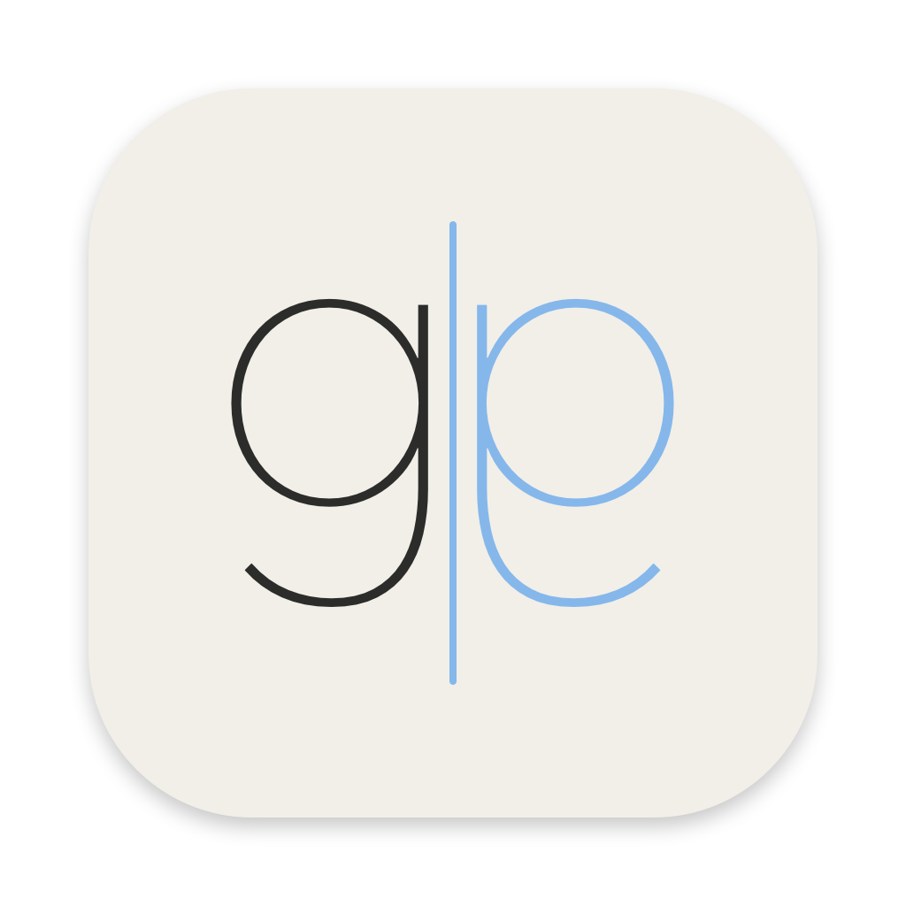
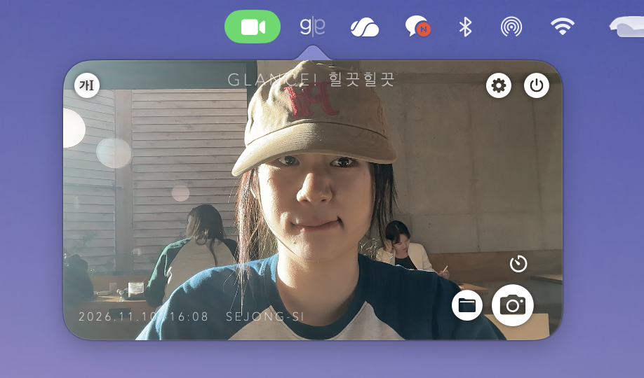
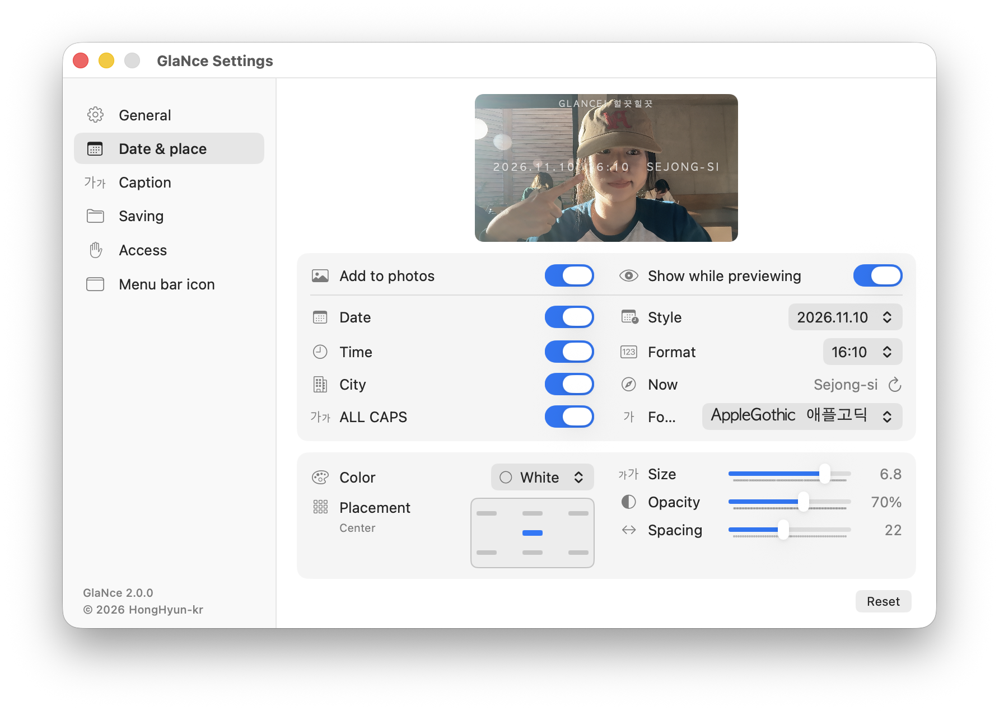
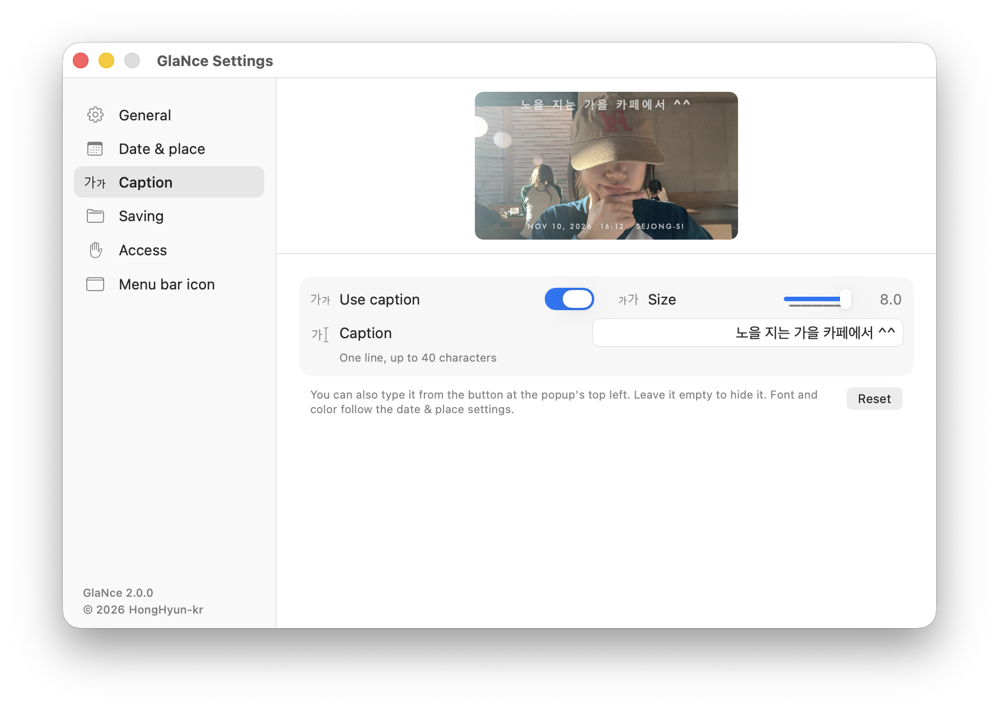
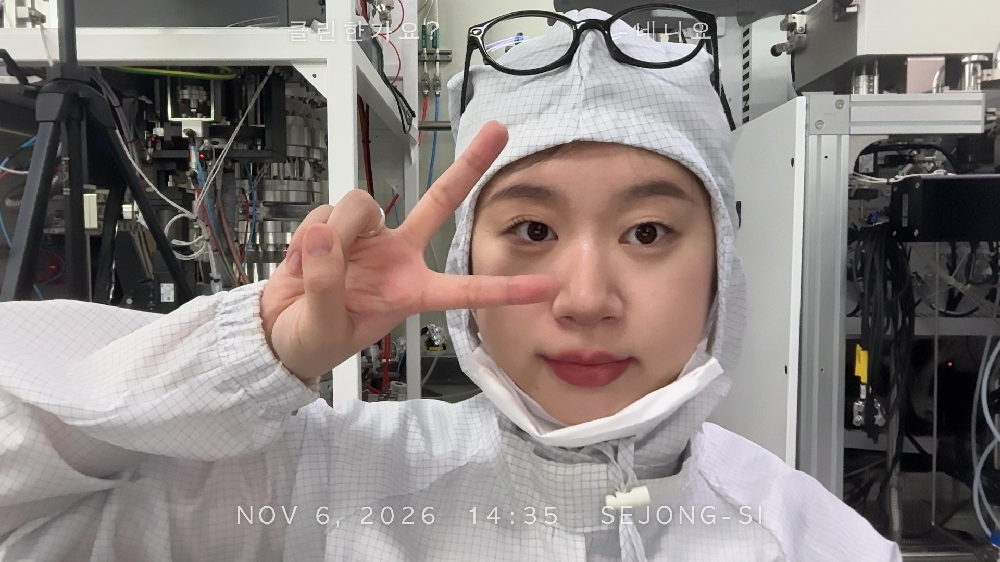
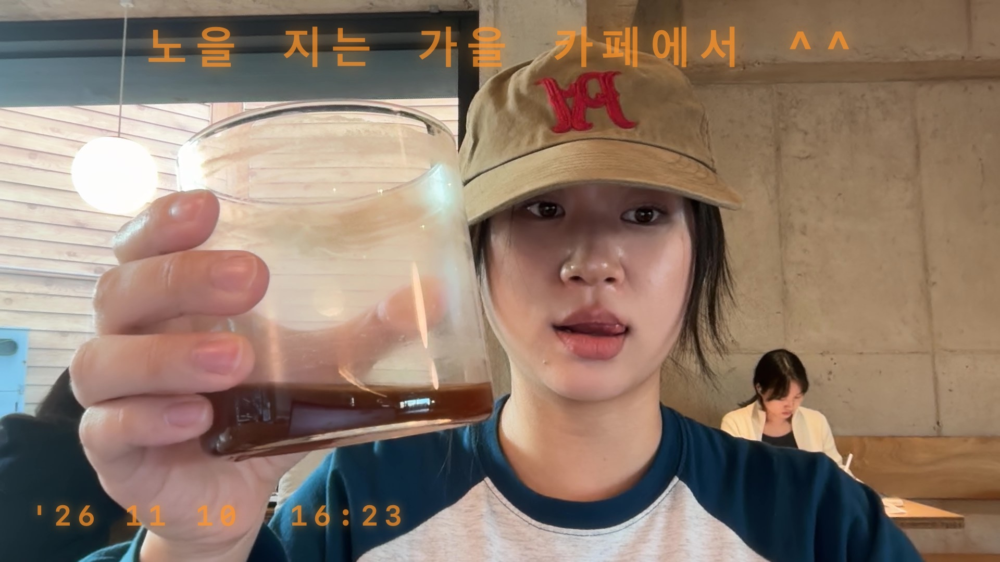

<p align="center">
  
</p>

<h1 align="center">GlaNce</h1>
<p align="center"><i>A quick look in the mirror, right from your menu bar.</i></p>

GlaNce is a tiny mirror camera that lives in the macOS menu bar. Click the icon to open a mirrored camera in a popover, check yourself, and snap a photo stamped with the date, time and city. Every shot is copied to your clipboard, so you can paste it anywhere with ⌘V.

It is a single Swift file built without Xcode. No account, no server, no tracking.



## Features

- **Menu bar mirror**: a mirrored camera in a speech-bubble popover. Drag it down to pop it out as an always-on-top floating window, or drag the bottom-right corner to resize it (10 steps).
- **Quick shooting**: press Space or Return, or click the shutter. A short flash confirms the shot, and a 3 s / 5 s timer sits right on the shutter.
- **Instant paste**: each photo is saved as JPEG and copied to the clipboard at the same time.
- **Date & place stamp**: date, time (24 h, 12 h or with seconds) and city, refreshed every time you open the camera. Seven fonts including AppleGothic and AppleMyungjo, white / black / retro orange film style, seven placements on a mini photo frame, and size, opacity and spacing controls.
- **Caption**: a one-line caption at the top of the photo. Click the top-left button or double-click the top of the view to type.
- **What you see is what you save**: the stamp and caption are drawn live on the camera view, at the same position and size as in the saved photo.
- **Photo shape**: 16:9, 4:3, 3:2 or 1:1. The preview and the saved photo are cropped the same way.
- **Settings**: sidebar tabs with a live camera preview, Korean / English, save folder, camera and location access, and ten menu bar icons.
- **Camera off when hidden**: the camera stops as soon as the popover and the settings window are closed.

| Date & place | Caption |
|---|---|
|  |  |
| **Saved photo** | **Retro orange** |
|  |  |

## Install

### Download

1. Get the latest `GlaNce_x.y.z.zip` from [Releases](../../releases) and unzip it.
2. Move `GlaNce.app` to `/Applications`.
3. The app is not notarized, so macOS blocks the first launch. Open **System Settings → Privacy & Security** and click **Open Anyway**, or run:
   ```bash
   xattr -dr com.apple.quarantine /Applications/GlaNce.app
   ```
4. Allow camera and location access when asked. Without location, only the date and time are stamped.

To start GlaNce at login, add it in **System Settings → General → Login Items**.

### Build from source

Only the Xcode Command Line Tools are needed (no Xcode).

```bash
xcode-select --install        # skip if already installed
git clone https://github.com/HongHyun-kr/GlaNce.git
cd GlaNce
bash build.sh                 # installs /Applications/GlaNce.app
open /Applications/GlaNce.app
```

`bash build.sh --zip` also creates `GlaNce_<version>.zip` for a release.

## Usage

| Action | How |
|---|---|
| Open / close the camera | Click the menu bar icon |
| Take a photo | Space, Return, or the shutter button |
| Timer | Timer button above the shutter (off → 3 s → 5 s). Press the shutter again to cancel |
| Caption | Top-left button, or double-click the top of the view. Press Return to finish |
| Resize | Drag the bottom-right corner |
| Floating window | Drag the camera view downward |
| Open the save folder | Folder button next to the shutter |
| Settings / Quit | Gear and power buttons at the top right |

## Requirements

- macOS 13 Ventura or later
- Apple Silicon or Intel (universal binary)

## Data

| | Location |
|---|---|
| Photos | `~/Pictures/GlaNce` by default (changeable in **Settings → Saving**) |
| Settings | `~/Library/Preferences/com.honghyun.glance.plist` |

Nothing leaves your Mac. Location is used only to look up the city name for the stamp.

To start fresh after reinstalling:

```bash
killall GlaNce
defaults delete com.honghyun.glance
tccutil reset All com.honghyun.glance
```

## Project layout

```
GlaNce.swift       the whole app (AppKit + SwiftUI + AVFoundation + CoreLocation)
Info.plist         app bundle metadata, camera and location usage text
make_icon.swift    draws the app icon (mirrored "g") at build time
build.sh           builds a universal binary, makes the .icns, signs and installs the app
icon/              app icon image for this README (1024 px)
docs/              screenshots for this README
```

## How it works

- **Menu bar UI**: `NSStatusItem` and a detachable `NSPopover` hosting SwiftUI. The popover follows the SwiftUI view size through `NSHostingController.sizingOptions`.
- **Camera**: one `AVCaptureSession` shared by the popover and the settings preview, started and stopped by a simple reference count.
- **Capture pipeline**: `AVCapturePhotoOutput` → Core Image crop and mirror → Core Graphics stamp and caption → JPEG file and clipboard.
- **Live overlay**: the preview draws the stamp with the same ratios as the saved photo and refreshes the time every second with `TimelineView`.
- **No Xcode**: `swiftc` and `lipo` build a universal binary, and the script assembles the `.app` bundle and icon.
- **Stable ad-hoc signing**: the designated requirement is pinned to the bundle ID, so camera and location permissions survive rebuilds.

## Releasing

```bash
bash build.sh --zip
```

Create a release with a `vX.Y.Z` tag on GitHub and attach the generated `GlaNce_X.Y.Z.zip`. Always upload the zip, not the `.app` itself, so the app keeps its executable permission.

## License

[MIT](LICENSE) © 2026 [HongHyun-kr](https://github.com/HongHyun-kr)
